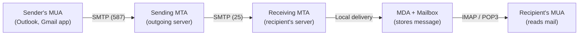

MD.SAMIR TAHRIAN
ID-IT24007

Video Link:https://drive.google.com/file/d/1LcplaIQSPOxyekNEOsnQLjQmptNK2unf/view?usp=sharing


<div align="center">

# 📧 Simple Mail Transfer Protocol (SMTP)

### How the Internet sends, relays and delivers email


**Mawlana Bhashani Science and Technology University**
Department of ICT · Santosh, Tangail

</div>

---

## 📖 About This Project

This repository contains a presentation on the **Simple Mail Transfer Protocol (SMTP)**, prepared for the course **Data Communication (ICT-3101)**. It explains how email moves across the Internet: from the sender's mail client, through relay servers, to the recipient's mailbox.

The presentation covers the protocol's history, architecture, commands, reply codes, a complete session walkthrough, MIME, ESMTP extensions, a comparison with POP3 and IMAP, email security, and real-world software.

## 👥 Presentation Details

| | Presented By | Supervised By |
|---|---|---|
| **Name** | MD. Samir Tahrian | Dr. Nazrul Islam |
| **Role** | Student (ID: IT-24007) | Associate Professor |
| **Department** | Dept. of ICT, MBSTU | Dept. of ICT, MBSTU |

**Course title:** Data Communication  **|**  **Course code:** ICT-3101

## 📑 Table of Contents

1. [Introduction and History](#1--introduction-and-history)
2. [Email System Architecture](#2--email-system-architecture)
3. [How an Email Travels](#3--how-an-email-travels)
4. [Characteristics and Ports](#4--characteristics-and-ports)
5. [Commands and Reply Codes](#5--commands-and-reply-codes)
6. [A Complete SMTP Session](#6--a-complete-smtp-session)
7. [Message Format and MIME](#7--message-format-and-mime)
8. [ESMTP Service Extensions](#8--esmtp-service-extensions)
9. [SMTP vs POP3 vs IMAP](#9--smtp-vs-pop3-vs-imap)
10. [Email Security](#10--email-security-threats-and-protections)
11. [Software and Applications](#11--smtp-software-and-applications)
12. [Advantages, Limitations and Conclusion](#12--advantages-limitations-and-conclusion)
13. [References](#-references)

---

## 1. 🌐 Introduction and History

SMTP is the standard **application-layer protocol** that moves email from a sender's mail client to the recipient's mail server.

| Property | Value |
|---|---|
| **Transport** | TCP (reliable) |
| **Well-known ports** | 25 · 587 · 465 |
| **Current core standard** | RFC 5321 |
| **Model** | Push (sender initiates the transfer) |

### Timeline

| Year | Milestone | Details |
|:---:|---|---|
| **1971** | First network email | Ray Tomlinson, ARPANET, uses the `@` sign |
| **1982** | RFC 821 | SMTP standardised (RFC 788 in 1981 was first) |
| **1995** | RFC 1869 | ESMTP: `EHLO` and extensions |
| **2008** | RFC 5321 | Current SMTP standard |
| **2018** | RFC 8314 | TLS by default for submission |

## 2. 🏗️ Email System Architecture



| Component | Full name | Role |
|---|---|---|
| **MUA** | Mail User Agent | The client a person uses to write and read email |
| **MSA** | Mail Submission Agent | Accepts new mail from clients, usually on port 587, after login |
| **MTA** | Mail Transfer Agent | Relays mail between servers using SMTP (Postfix, Exim, Exchange) |
| **MDA** | Mail Delivery Agent | Places the final message into the user's mailbox |

## 3. 🚚 How an Email Travels

| Step | Stage | What happens |
|:---:|---|---|
| 1 | **Compose** | The user writes the message in a mail client (MUA) |
| 2 | **Submit** | The client sends it to the outgoing server over SMTP, usually port 587, after login |
| 3 | **DNS lookup** | The sending MTA asks DNS for the MX record of the recipient's domain |
| 4 | **Relay** | It opens a TCP connection to the receiving MTA on port 25 and transfers the message |
| 5 | **Deliver** | The MDA stores the message in the recipient's mailbox |
| 6 | **Retrieve** | The recipient reads it using IMAP, POP3 or webmail |

> **💡 DNS and MX records:** a lower preference number means higher priority; backup MX servers accept mail if the primary is down; with no MX record the sender falls back to the domain's A/AAAA record.

## 4. ⚙️ Characteristics and Ports

**Key characteristics**

- **Text-based:** readable ASCII commands and replies ending in CRLF
- **Runs over TCP:** reliable, ordered delivery
- **Push protocol:** the sender pushes mail; it cannot pull
- **Client-server:** the sending side is the client, the receiving side the server
- **Command-reply:** every command gets a numeric reply code
- **Store and forward:** servers queue mail and retry later

**Ports**

| Port | Name | Purpose | Encryption |
|:---:|---|---|---|
| **25** | SMTP | Server-to-server relay (MTA to MTA) | Optional STARTTLS |
| **587** | Submission | Client to server submission (RFC 6409) | STARTTLS and login |
| **465** | SMTPS | Submission over implicit TLS (RFC 8314) | TLS from first byte |
| **2525** | Alternative | Unofficial fallback used by some providers | Usually STARTTLS |

## 5. 💬 Commands and Reply Codes

**Commands**

| Command | Purpose |
|---|---|
| `EHLO` | Greets the server and lists its extensions |
| `MAIL FROM` | Starts a transaction with the sender address |
| `RCPT TO` | Names one recipient (repeat for more) |
| `DATA` | Begins the message; ends with a lone dot line |
| `RSET` | Aborts the current transaction |
| `VRFY` | Checks whether a mailbox exists (often disabled) |
| `STARTTLS` | Upgrades the connection to TLS |
| `AUTH` | Authenticates the client (RFC 4954) |
| `QUIT` | Ends the session politely |

**Reply codes**

| Code | Meaning | Examples |
|:---:|---|---|
| **2xx** | ✅ Success | 250 OK, 220 Ready, 221 Closing |
| **3xx** | 🔵 Intermediate | 354 Start mail input |
| **4xx** | 🟠 Temporary failure | 421 Unavailable, 450 Mailbox busy |
| **5xx** | 🔴 Permanent failure | 550 No such mailbox, 554 Failed |

## 6. 🖥️ A Complete SMTP Session

```text
S: 220 mx.example.com ESMTP ready
C: EHLO mail.sender.org
S: 250 mx.example.com Hello
C: MAIL FROM:<alice@sender.org>
S: 250 2.1.0 Sender OK
C: RCPT TO:<bob@example.com>
S: 250 2.1.5 Recipient OK
C: DATA
S: 354 Start mail input
C: From: Alice <alice@sender.org>
C: To: Bob <bob@example.com>
C: Subject: Hello
C:
C: Hi Bob, this is a test.
C: .
S: 250 2.0.0 Queued as 4F2A1
C: QUIT
S: 221 2.0.0 Closing connection
```

> `S:` = Server  ·  `C:` = Client

| Phase | Description |
|:---:|---|
| **1. Greeting** | Server announces readiness (220); client identifies itself with `EHLO` |
| **2. Envelope** | `MAIL FROM` and `RCPT TO` name the sender and recipients |
| **3. Data** | Headers, a blank line, then the body, ended by a lone dot |
| **4. Close** | Server queues the message (250); `QUIT` ends the session |

## 7. ✉️ Message Format and MIME

An email has three parts:

- **Envelope** (used by SMTP): `MAIL FROM` and `RCPT TO`
- **Header** (RFC 5322): `Received`, `From`, `To`, `Subject`, `Date`, `Message-ID`
- **Body:** text, HTML and attachments (MIME parts) after one blank line

**MIME (RFC 2045)** lets 7-bit ASCII SMTP carry attachments, images and non-English text.

```text
MIME-Version: 1.0
Content-Type: multipart/mixed; boundary="X"
Content-Transfer-Encoding: base64
```

| Content-Type | Used for |
|---|---|
| `text/plain`, `text/html` | Message text |
| `multipart/mixed` | Attachments |
| `multipart/alternative` | Plain + HTML |
| `application/pdf` | Documents |

## 8. 🧩 ESMTP Service Extensions

| Extension | RFC | What it adds |
|---|:---:|---|
| `STARTTLS` | 3207 | Upgrade a plain connection to TLS encryption |
| `AUTH` | 4954 | Client authentication (PLAIN, LOGIN, OAuth) |
| `SIZE` | 1870 | Declare message size and server limit before sending |
| `8BITMIME` | 6152 | Send 8-bit data without extra encoding |
| `PIPELINING` | 2920 | Send several commands without waiting for each reply |
| `DSN` | 3461 | Delivery status notifications (success, delay, failure) |
| `CHUNKING` | 3030 | Transfer large messages in binary chunks (BDAT) |
| `SMTPUTF8` | 6531 | Internationalised addresses and headers (UTF-8) |

## 9. ⚖️ SMTP vs POP3 vs IMAP

| Feature | SMTP | POP3 | IMAP |
|---|---|---|---|
| **Purpose** | Send and relay mail | Download mail | Access and sync mail |
| **Direction** | Push | Pull | Pull and synchronise |
| **Ports** | 25, 587, 465 | 110, 995 (TLS) | 143, 993 (TLS) |
| **Mail stored** | In server queues in transit | On the device; often removed from server | Kept on the server |
| **Multiple devices** | Not applicable | Limited | Excellent |
| **Specification** | RFC 5321 | RFC 1939 | RFC 9051 (IMAP4rev2) |

## 10. 🔐 Email Security: Threats and Protections

### 🔴 Threats

- Sender spoofing: the `From` address is not verified
- Spam and phishing
- Open relay abuse
- Eavesdropping (MITM) without TLS
- STARTTLS stripping (downgrade)
- Malware attachments and mail bombing

### 🔵 Protections

| Technique | RFC | How it works |
|---|:---:|---|
| **SPF** | 7208 | Domain lists the IPs allowed to send its mail in DNS; receivers check the sending IP |
| **DKIM** | 6376 | Sender signs the message with a private key; receivers verify with the public key in DNS |
| **DMARC** | 7489 | Requires domain alignment with SPF or DKIM; policy is `none`, `quarantine` or `reject` |

**Receiver checks:** SPF → DKIM → DMARC policy → inbox, spam or reject. Gmail and Yahoo require this for bulk senders (2024).

**Also:** TLS / STARTTLS, SMTP AUTH, MTA-STS and DANE.

## 11. 🛠️ SMTP Software and Applications

| Software / Service | Highlights |
|---|---|
| **Postfix** | Open-source MTA by Wietse Venema (1998); secure and fast |
| **Sendmail** | Open-source MTA by Eric Allman (1983); very configurable |
| **Exim** | Open-source MTA from Cambridge (1995); Debian default |
| **Microsoft Exchange** | Enterprise mail and calendar server for Windows |
| **Gmail SMTP** | `smtp.gmail.com` on port 587 (STARTTLS) or 465 (TLS) |
| **Amazon SES, SendGrid** | Cloud services with API or SMTP interface for bulk mail |

**Real-world applications**

- Transactional email: OTP, receipts, password resets
- Alerts: banking, security, monitoring
- Newsletters and marketing campaigns
- Institutional communication: universities, offices
- Automated reports and backups
- Web apps, IoT devices and printers via relay

## 12. ✅ Advantages, Limitations and Conclusion

| 👍 Advantages | 👎 Limitations |
|---|---|
| Simple, text-based and easy to debug | No built-in sender authentication |
| Universal: every provider can exchange mail | Plain text unless TLS is used |
| Store-and-forward queues with retries | Push only: needs POP3 or IMAP to read mail |
| Extensible through ESMTP | Spam, abuse and size limits (e.g. 25 MB) |

### Conclusion

After more than 40 years, **SMTP remains the backbone of Internet email** because it is simple, extensible and universal.

**Future:** wider MTA-STS, DANE and DMARC enforcement, UTF-8 addresses and AI-based spam filtering.

---

## 📚 References

1. J. Klensin, "Simple Mail Transfer Protocol," RFC 5321, IETF, Oct. 2008.
2. P. Resnick, "Internet Message Format," RFC 5322, IETF, Oct. 2008.
3. N. Freed and N. Borenstein, "MIME Part One: Format of Internet Message Bodies," RFC 2045, Nov. 1996.
4. P. Hoffman, "SMTP Service Extension for Secure SMTP over TLS," RFC 3207, Feb. 2002.
5. S. Kitterman, "Sender Policy Framework (SPF)," RFC 7208, Apr. 2014.
6. D. Crocker, T. Hansen and M. Kucherawy, "DomainKeys Identified Mail (DKIM) Signatures," RFC 6376, Sep. 2011.
7. M. Kucherawy and E. Zwicky, "DMARC," RFC 7489, Mar. 2015.
8. K. Moore and C. Newman, "Cleartext Considered Obsolete: Use of TLS for Email Submission and Access," RFC 8314, Jan. 2018.
9. J. Kurose and K. Ross, *Computer Networking: A Top-Down Approach*. Pearson.

---

<div align="center">

**Presented by MD. Samir Tahrian (IT-24007)**
Department of ICT, Mawlana Bhashani Science and Technology University

*Supervised by Dr. Nazrul Islam, Associate Professor*

⭐ If you found this useful, consider giving the repository a star!

</div>
